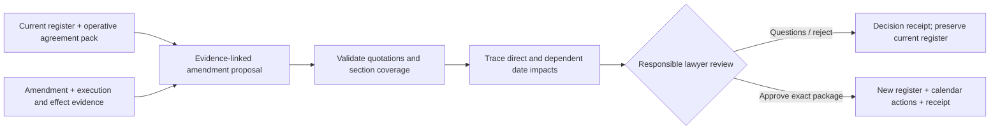
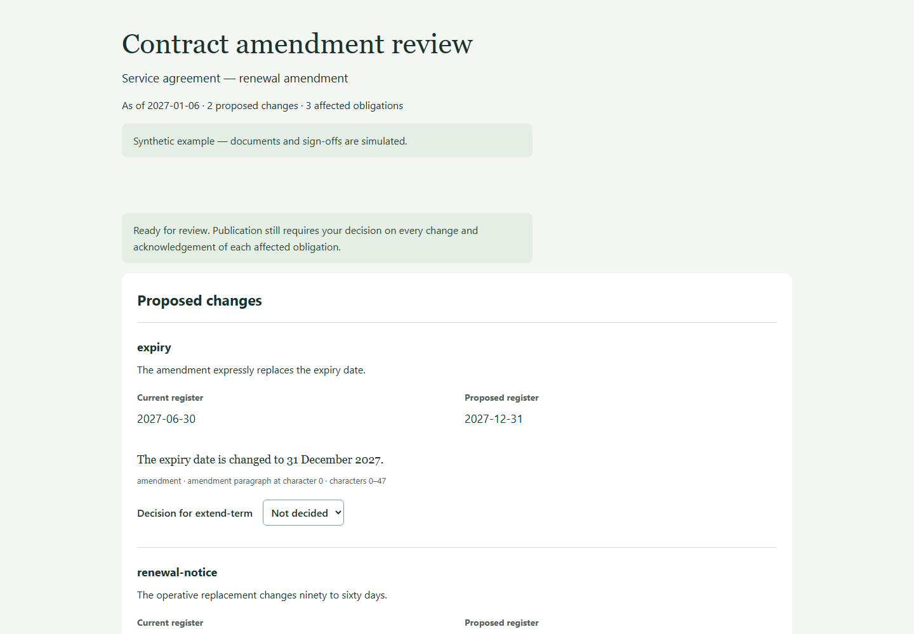

# oblig-register

Turn an executed contract into a dated obligations register. A validated YAML schema for
"who must do what, by when, or else", deadline resolution with a trace, `.ics` export with
reminders, and a skill for the extraction step. Review later amendments against the
existing register, trace affected dates and publish a new version after approval.

```yaml
- id: non-renewal-notice
  obligor: Beta Manufacturing Pte Ltd
  obligee: Acme Cloud Pte Ltd
  category: renewal
  description: Last day to give notice of non-renewal
  clause_ref: "8.3"
  verbatim: "... unless either party gives written notice of non-renewal not less than ninety (90) days before the expiry of the then-current term."
  trigger:
    kind: relative
    relative: { anchor: expiry, days: 90, direction: before }
  consequence: Automatic renewal for 12 months
  lead_days: 45
```

```
$ obligreg -j SG resolve examples/sample-register.yaml
non-renewal-notice: Last day to give notice of non-renewal
clause 8.3: "... not less than ninety (90) days before the expiry ..."
anchor expiry: 2029-02-28
- 90 calendar day(s) = 2028-11-30
  => 2028-11-30
```

## Why

After signing, an in-house team needs a maintained record of obligations, dates and
reminders. Amendments can make that record stale even when the underlying document
change looks small. The auto-renewal nobody noticed, the insurance
certificate that was due in 14 Business Days, the 120-day price-increase window: these are
operational failures, not drafting failures, and they are avoidable with a spreadsheet
that someone keeps. This is the spreadsheet, as data, with the arithmetic done.

## What is in the box

| Piece | What it does |
|---|---|
| `schema/register.schema.json` | JSON Schema for a register, generated from the pydantic model. |
| `obligreg validate` | Duplicate ids, obligors that are not parties, dangling anchors, missing quotations, malformed triggers. |
| `obligreg resolve` | Every deadline with a line-by-line trace. Relative triggers chain (`data-deletion` anchored on `data-return` anchored on `event:termination`). Business days via [sg-deadline](https://github.com/kevanwee/sg-deadline). |
| `obligreg render` | Markdown register, dated items first, undated event-triggered items listed separately, notice clause summarised. |
| `obligreg ics` | RFC 5545 calendar: one all-day event per obligation, `RRULE` for recurrences, `VALARM` at `lead_days`. Stable UIDs identify updates; import behaviour depends on the calendar client. |
| `obligreg upcoming` | What is due in the next N days from a date. |
| `SKILL.md` | The extraction discipline: sweep every clause, quote the operative words, classify the trigger, extract the notice clause as deemed-receipt parameters. |

## Amendment impact review

An amendment changes expiry and the notice period. The review traces the new notice
deadline, its dependent escalation and the longer recurring-report schedule. A shared
Business Day definition can affect obligations that the amendment never names directly.





Start with the complete [step-by-step method](references/amendment-review.md). Three
[synthetic scenarios](examples/amendments/) cover renewal, a Business Day definition
and an ambiguous amendment that blocks approval. The same engine supports amendment
review inside the private Legal Engineering Workspace Studio.

```bash
obligreg amend build --base examples/amendments/renewal/base.yaml --plan examples/amendments/renewal/proposal.json --out out/review-v2
# Open out/review-v2/review.html, review each change and impact, then download a decision.
obligreg amend apply --base examples/amendments/renewal/base.yaml --plan examples/amendments/renewal/proposal.json --review out/review-v2 --decision amendment-decision.json --out out/approved-v2
```

| Scenario | Verified mechanical result |
| --- | --- |
| Renewal and notice | Notice: 1 Apr ? 1 Nov 2027; escalation: 18 Mar ? 18 Oct; monthly reports: 6 ? 12 |
| Business Day definition | Insurance: 7 ? 8 Jan 2027; dependent review: 10 ? 11 Jan |
| Ambiguous amendment | Approval blocked; rejection publishes no replacement register or calendar |

Approval requires every change accepted, every affected obligation acknowledged and
no unresolved blocker. Changed inputs or presentation require renewed review. The
original register is preserved. `calendar-changes.json` gives explicit create/update/
cancel actions; no external calendar is modified. Actor names record attestations,
not authenticated authority. Quotations prove provenance, not legal adequacy.

Schema 1.1 adds an optional Business Day rule and loads earlier unversioned registers.
The original schema is preserved as `schema/register.v1.schema.json`. No Python clause
parser or automatic legal interpretation is introduced.

## Install

```bash
pip install -e ".[dev]"
pip install "sg-deadline @ git+https://github.com/kevanwee/sg-deadline.git@1ab1994dc79980d43ebdea8bd635f7776e5ed79e"
pip install -e ".[sg]"       # uses that reviewed 0.2+ engine
```

As a Claude skill: clone into `.claude/skills/obligation-extraction/`.

## Triggers

| Kind | Example wording | YAML |
|---|---|---|
| `fixed` | "by 31 December 2026" | `{ kind: fixed, date: 2026-12-31 }` |
| `relative` | "within 14 Business Days after the Effective Date" | `{ kind: relative, relative: { anchor: effective_date, business_days: 14 } }` |
| `relative` | "not less than 90 days before expiry" | `{ anchor: expiry, days: 90, direction: before }` |
| `relative` | "within 30 days after the retrieval period" | `{ anchor: data-return, days: 30 }` |
| `event` | "within 48 hours of confirming a breach" | `{ kind: event, event: data-breach-confirmed }` |
| `recurring` | "monthly report by the 7th" | `{ kind: recurring, recurrence: { freq: monthly, day_of_month: 7 } }` |

Event-triggered obligations stay **unresolved** until you date the event in the register's
`events:` map; then everything chained on them resolves. Business-day periods stay
unresolved unless a working-day calendar is supplied (`-j SG` with sg-deadline installed).
The tool never approximates a business-day period as calendar days.

## Notice clause

The register carries the notice clause as data: addresses per party and, per permitted
method, the deemed-receipt parameters (`offset_days`, `business_days`, `cutoff`,
`non_working_day_defers`). These are exactly the inputs to sg-deadline's
`deemed_receipt_date`, so "when is this notice deemed received?" is a tool call, not a
guess.

## Calendar export

```bash
obligreg -j SG ics examples/sample-register.yaml -o acme-beta.ics
```

Import into Outlook, Google Calendar or Apple Calendar. Each event's description contains
the clause reference, the quotation, the parties, the consequence of default, and the
resolution trace, so the reminder is self-explaining when it fires in two years' time.

## What this is not

- Not an extractor. The skill (a reader with the contract in front of it) fills in the
  register; the library validates and computes. Extraction quality is the reader's
  responsibility, which is why `verbatim` is mandatory.
- Not a matter-management system. It produces files.
- Not legal advice. The sample register is fictional.

## Related projects

[sg-deadline](https://github.com/kevanwee/sg-deadline) for calendars and deemed receipt; [playbook-as-code](https://github.com/kevanwee/playbook-as-code)
for the pre-signature review that precedes this.

## License

MIT.
